  

# 🚀 Awesome Demo &amp; Sandbox Enterprise Environment

**A definitive, SEO-optimized curated catalog of Enterprise Demo Platforms, Environments-as-a-Service (EaaS), Ephemeral Preview Infrastructure, Cloud Sandboxes, and Disposable Staging Environments.**

*Accelerating Pull Request Previews ⚡ Zero Staging Conflicts 🛡️ Safe Live Sales Demos 💰 Automated Teardown &amp; Cost Control*

---

## 📑 Table of Contents
- [📌 Overview &amp; Why Ephemeral Sandboxes?](#-overview--why-ephemeral-sandboxes)
- [📊 Sector Overview &amp; Market Dynamics](#-sector-overview--market-dynamics)
- [🏢 SaaS &amp; Commercial Hosted Platforms](#-saas--commercial-hosted-platforms)
- [💻 Open-Source GitHub Projects](#-open-source-github-projects)
- [📈 Star History](#-star-history)
- [🤝 How to Contribute](#-how-to-contribute)
- [💖 Support &amp; Community](#-support--community)
- [⚠️ Disclaimer](#️-disclaimer)

---

## 📌 Overview &amp; Why Ephemeral Sandboxes?

Traditional static staging environments are notoriously plagued by **queue bottlenecks**, **configuration drifts**, **costly idle resources**, and **data pollution**. 

**Ephemeral environments** (also known as *Preview Environments*, *On-Demand Sandboxes*, or *Environments-as-a-Service / EaaS*) spin up dynamic, isolated copies of your entire application stack—including frontend, backend microservices, third-party mock services, and seeded databases—for every single Pull Request (PR) or on-demand sales demo. Once the code review is merged or the demo concludes, the environment is automatically decommissioned, saving substantial cloud expenditures while guaranteeing 100% environment fidelity.

### 🌟 Key Capabilities
- ⚡ **Instant PR Previews**: Automated URL generated on each commit for rapid product, design, and QA feedback.
- 🧪 **Isolated Sandboxing**: Complete tenant isolation without impacting production or shared mainline environments.
- 💰 **Automated TTL &amp; FinOps**: Enforce Time-To-Live expiration policies to stop or delete idle Kubernetes/VM clusters.
- 🎯 **Sales Demo Reliability**: Deliver clean, deterministic demo instances tailored for prospective enterprise clients.

---

## 📊 Sector Overview &amp; Market Dynamics

The **Test Environment-as-a-Service (TEaaS)** and cloud sandboxing ecosystem is currently valued at **~$20B+ combined** (with TEaaS at ~$17.7B and cloud sandboxing at ~$2.8B, expanding toward **$50B+ by the early 2030s** at an estimated ~16% CAGR). 

The sector remains **moderately fragmented**: mega-cap enterprise suites and hyperscalers (Microsoft Dynamics, Oracle Cloud, Salesforce) capture core ERP/CRM ecosystem sandboxes, while a dynamic, highly contested cohort of specialized developer platforms and open-source orchestration engines (Vercel, LocalStack, Daytona, vCluster, Okteto, Coder) compete aggressively for cross-cloud ephemeral preview infrastructure and modern GitOps workflows.

---

## 🏢 SaaS &amp; Commercial Hosted Platforms

| Product | Company Scale (Valuation / Revenue) | Description | Starting Price | Free Tier / Trial Limits |
|:---|:---|:---|:---|:---|
| **[Microsoft Business Central Preview Environments](https://learn.microsoft.com/en-us/dynamics365/business-central/dev-itpro/administration/preview-environments)** | ~$3.1T Market Cap (~$245B Annual Revenue) | Sandbox environments on preview versions of Business Central for testing upcoming releases and configuration. | **$80/user/month** (Essentials plan, annual commitment) | **30-day free trial**; test drive full business functionality using sample data or custom tenant data without upfront credit card requirements. |
| **[Oracle Sandboxes](https://docs.oracle.com/en/cloud/saas/applications-common/26d/oaext/overview-of-sandboxes.html)** | ~$400B Market Cap (~$53B Annual Revenue) | Isolated environments for testing enterprise configuration and extension changes without impacting mainline runtime. | **Included with Oracle Cloud Applications** (or OCI Pay As You Go from **$0.025/OCPU-hr**) | **30-day trial with $300 cloud credits** + **Always Free tier** (2 AMD Micro VMs, 4 Arm Ampere cores, 200 GB block storage, Autonomous DBs). |
| **[Salesforce Scratch Orgs](https://developer.salesforce.com/)** | ~$280B Market Cap (~$35B Annual Revenue) | Fully configurable, disposable Salesforce environments for source-driven development, testing, and continuous integration. | **$0** (Included with Salesforce Developer Edition; Enterprise starts at **$165/user/month**) | **Free forever Developer Edition** includes active Dev Hub allocating up to **3 active scratch orgs** (6 daily creations, configurable 1–30 days lifespan, 200 MB data / 50 MB file limit). |
| **[Vercel Preview Environments](https://vercel.com/)** | ~$9.3B Valuation (~$200M ARR) | Automatic ephemeral preview deployments for every Git branch/PR with unique shareable URLs and zero-config frontend framework support. | **$20/user/month** (Pro plan) | **Free forever Hobby plan** (Personal non-commercial use, 100 GB bandwidth/mo, automatic preview deployments per git branch, unlimited serverless function executions up to fair use caps). |
| **[LocalStack](https://localstack.cloud/)** | ~$150M–$250M Valuation (~$28M Total Funding) | Fully functional local and cloud-emulated AWS runtime for integration testing, sandboxing, and offline development. | **$39/license/month** (Base plan billed annually, or $45/mo monthly) | **Free forever Hobby plan** (Non-commercial usage; requires free account and auth token; includes 30+ core AWS services like S3, Lambda, and DynamoDB). |
| **[Release.com](https://release.com/)** | ~$80M–$100M Valuation (~$23M Total Funding) | Environments-as-a-Service platform deploying ephemeral full-stack preview and demo environments inside customer AWS/GCP accounts. | **Custom enterprise quote** (Workload-based in customer VPC; typically starts ~$1,000–$2,000/mo depending on cluster scale) | **14-day guided proof-of-concept (PoC) / trial** available upon sales consultation with full platform features on customer cloud infrastructure. |
| **[Okteto](https://okteto.com/)** | ~$60M Valuation (~$18M Total Funding) | Kubernetes-native preview and remote development environments with instantaneous hot-reloading and PR preview automation. | **Custom enterprise quote** (Scale & Enterprise tiers; priced per user seat) | **Free forever Starter plan** for up to **5 users** (unlimited development, PR preview, and AI agent environments on your Kubernetes cluster; no credit card required). |
| **[Bunnyshell](https://www.bunnyshell.com/)** | ~$20M–$30M Valuation (~$11.5M Total Funding) | Ephemeral environments platform automating Kubernetes-native preview infrastructure, staging environments, and customer demos. | **$0.07/minute** (~$4.20/active hour) pay-as-you-go per active environment on Startup tier (no fixed monthly seat fee) | **14-day free trial** with full platform features and environment orchestration; billing automatically pauses when environments are stopped. |
| **[Uffizzi](https://www.uffizzi.com/)** | ~$10M–$15M Valuation (~$2.8M Total Funding) | Full-stack ephemeral environment control plane provisioning preview environments per PR with custom domain routing and dependencies. | **$20/month** (Starter / Pro baseline tier) | **Free forever tier** supporting up to **2 concurrent ephemeral environments** (ideal for open-source and indie developers) + **14-day free trial** for Business tiers. |

---

## 💻 Open-Source GitHub Projects

*Ranked by GitHub popularity (descending):*

| Project | Star Badge | Description |
|:---|:---|:---|
| **[Daytona](https://github.com/daytonaio/daytona)** |  | Open-source development environment manager and sandbox orchestrator. Automatically provisions standardized, isolated remote development workspaces and ephemeral environments on any infrastructure (Docker, Kubernetes, cloud VMs) with a single CLI command. |
| **[LocalStack](https://github.com/localstack/localstack)** |  | A fully functional local AWS cloud stack. Develop and test your cloud & serverless apps offline, spinning up disposable AWS sandbox services locally without incurring cloud bills. |
| **[Coder](https://github.com/coder/coder)** |  | Open-source cloud development environment (CDE) platform provisioned via Terraform. Deploys reproducible, secure developer workspaces and demo sandboxes on any Kubernetes cluster, VM, or public cloud. |
| **[Gitpod](https://github.com/gitpod-io/gitpod)** |  | Open-source developer platform for automated, ephemeral development environments and interactive sandboxes that launch directly from GitLab, GitHub, or Bitbucket. |
| **[vcluster](https://github.com/loft-sh/vcluster)** |  | Virtual Kubernetes clusters that run fully functional, isolated lightweight k8s control planes inside a namespace of any underlying host cluster. Perfect for ephemeral PR testing, tenant isolation, and disposable sandbox environments. |
| **[DevSpace](https://github.com/loft-sh/devspace)** |  | Client-only developer tool for Kubernetes that builds, deploys, and updates cloud-native apps directly inside ephemeral or staging namespaces with real-time code synchronization. |
| **[Okteto CLI](https://github.com/okteto/okteto)** |  | Open-source CLI to build, deploy, and manage ephemeral preview environments and development environments in any Kubernetes cluster for instant feedback loops on PRs. |
| **[Qovery Engine](https://github.com/qovery/engine)** |  | The core open-source abstraction engine behind Qovery, providing orchestration logic to spin up isolated preview environments and microservices on AWS, GCP, Azure, and Kubernetes. |
| **[Kurtosis](https://github.com/kurtosis-tech/kurtosis)** |  | Open-source orchestrator for spinning up reproducible, multi-container ephemeral test environments and sandbox networks (Docker & Kubernetes) using declarative Starlark packages. |
| **[Uffizzi](https://github.com/UffizziCloud/uffizzi)** |  | Open-source composable preview environment engine designed to run full-stack ephemeral testing sandboxes triggered by Git pull requests using Docker Compose, Helm, or raw Kubernetes manifests. |
| **[GoodRx Lifecycle](https://github.com/GoodRxOSS/lifecycle)** |  | Ephemeral environments platform with selective microservice previews and automatic fallback to shared staging. Open-sourced by GoodRx to reduce cloud infrastructure costs while maintaining isolation. |
| **[DeployStack](https://github.com/deploystackio/deploystack)** |  | Open-source preview environments engine that creates complete ephemeral environments for each pull request directly on your cloud infrastructure. |
| **[K8s Ephemeral Environments](https://github.com/koder-cat/k8s-ephemeral-environments)** |  | Full-stack preview environments with databases for every PR. Designed as a self-hosted alternative to Vercel/Qovery on a single k3s VPS (targeting <$120/month). |
| **[Cella](https://github.com/latere-ai/cella)** |  | Open-source sandbox orchestration for AI agents and isolated workloads with Kubernetes, Podman, and local process isolation drivers and signed mutation sinks. |
| **[MavMeta](https://github.com/Syntax-Syllogism/MavMeta)** |  | Salesforce administrator & developer GUI providing guided scratch org and sandbox management directly on localhost without cloud credential persistence. |
| **[scratchpool](https://github.com/Tbristo01/scratchpool)** |  | Self-refilling pool of warm Salesforce scratch orgs for instant ~2-second claims from CLI or AI coding agents. |

---

## 📈 Star History

---

## 🤝 How to Contribute

Contributions are warmly welcome! If you know of an awesome ephemeral preview environment tool or open-source sandbox platform:

1. 🍴 **Fork the repository**.
2. 🌿 **Create a feature branch** (`git checkout -b feature/add-new-sandbox-platform`).
3. 📝 **Add or edit entries in `README.md`** following the existing tabular structure (include specific starting pricing, free tier / trial terms, star count badge, and clear technical descriptions).
4. ✨ **Commit your changes** (`git commit -m 'feat: add NewSandboxPlatform'`).
5. 🚀 **Push to the branch** (`git push origin feature/add-new-sandbox-platform`).
6. 📬 **Open a Pull Request** with a brief summary of the project.

---

## 💖 Support & Community

If you find this curated collection useful, please consider supporting the project:

- ⭐ **Star this repository** to help others discover it!
- 🍴 **Fork & share** with your DevOps, Platform Engineering, and QA teams.
- 💬 **Join our community on Discord** to discuss ephemeral environments and cloud sandboxing.
- ☕ **Buy me a coffee / Sponsor the project**: Support maintenance and continuous updates on GitHub Sponsors:

  

---

## ⚠️ Disclaimer

- This is a **community-curated** list — provided for informational and architectural evaluation purposes.
- Demo and sandbox environments frequently handle production-like schemas or synthetic customer data; always ensure stringent data masking, credential isolation, and automated teardown mechanisms.
- Ephemeral environments require disciplined lifecycle governance (time-to-live expiration) to avoid unexpected cloud infrastructure costs.
